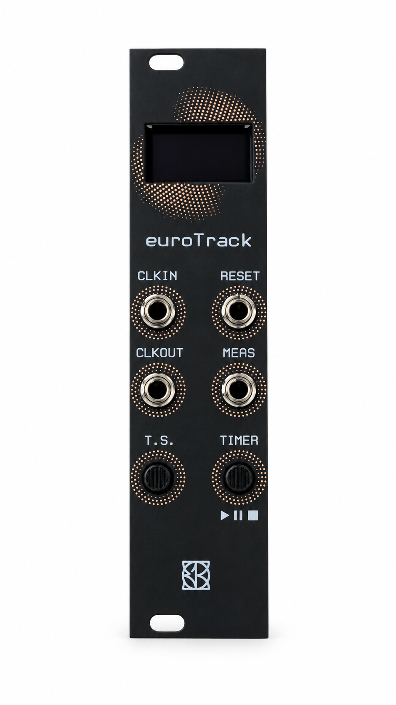
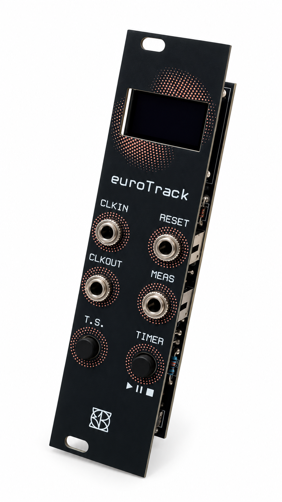
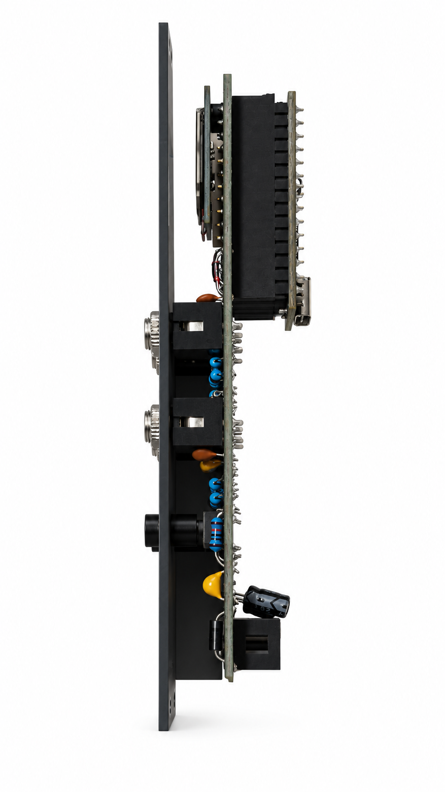

# euroTrack

### Keep your place in the patch.

**An open-source Eurorack bar/beat counter, performance timer and clock utility.** Follow the musical position of an external clock, mark longer phrases, or run from the internal tempo — with a selectable **BAR/BEAT** or **TIMER** display.

 

More product views

Product photographs retouched with AI for background and lighting. [Photo notes](PHOTO_EDIT_NOTES.md).

[Quick start and controls](docs/USER_GUIDE.md) · [Guida italiana](docs/GUIDA_IT.md) · [Firmware](firmware/Eurotrack_V4_1_SingleFile/Eurotrack_V4_1_SingleFile.ino) · [Build and modify](docs/DEVELOPMENT.md) · [Schematics](hardware/schematics/README.md)

## At a glance

- **Musical position:** bars 1–9999, grouped beats and an elapsed-time display.
- **Seven meters:** 4/4, 3/4, 6/8, 5/4, 7/8, 9/8 and 12/8. Compound meters display rhythmic groups: 6/8 is two groups of three eighths; 7/8 is 2+2+3.
- **Phrase markers:** MEAS pulses at the first bar and every 1, 2, 4, 8 or 16 bars, with selectable 5/10/20/50 ms pulse targets.
- **External priority:** CLKIN expects **4 PPQN**, one pulse per sixteenth note. CLKOUT follows external transitions in software, or emits the internal clock when active.
- **Internal clock:** 50–250 BPM in steps of 5; enabled in the menu and active while the timer runs. It starts disabled after power-on.
- **Performance timer:** start, pause, resume and long-press stop/reset, with optional coupling to the bar counter.
- **Two screen layouts:** BAR/BEAT for prominent musical position, TIMER for larger HH:MM:SS. The chosen view and musical settings persist in EEPROM.

## Start patching

1. Connect a compatible **4 PPQN** source to **CLKIN**. At 120 BPM this is eight pulses per second. A different PPQN changes the displayed tempo and musical count.
2. The first accepted clock edge starts **bar 1 / beat 1** and produces a MEAS marker. Connect MEAS to a compatible trigger destination for phrase events.
3. Press **T.S.** once to open meter selection, then again to advance through the meters. Selection closes after three seconds.
4. Press **TIMER** briefly for start/pause/resume; hold about **one second** to stop and clear elapsed time.
5. Hold **T.S. + TIMER** for one second, release both, then use T.S. to select a menu item and TIMER to change it. **DISPLAY VIEW is item 7/8**, SAVE/EXIT is 8/8.

The clock-driven musical count continues during timer pause when using an external source. RESET is applied on the next clock edge; its optional BAR+TIME behavior also stops/clears the timer. Read the [full guide](docs/USER_GUIDE.md) for menu options, persistence and clock loss.

## Current firmware: V4.1

Baseline dated **20 October 2026**, for **classic Arduino Nano ATmega328P, 16 MHz**, with **SSD1306 I2C 128 × 64 at 0x3C**.

| Distribution | Open in Arduino IDE | Purpose |
| --- | --- | --- |
| **Single file — recommended for installation** | [Eurotrack_V4_1_SingleFile.ino](firmware/Eurotrack_V4_1_SingleFile/Eurotrack_V4_1_SingleFile.ino) | Complete sketch with the settings class embedded; no missing local header |
| **Modular source** | [Eurotrack_V4_1.ino](firmware/Eurotrack_V4_1/Eurotrack_V4_1.ino), with [SettingsStore.h](firmware/Eurotrack_V4_1/SettingsStore.h) beside it | Easier to inspect and modify persistence; includes the regression suite |

Both forms implement the same V4.1 behavior and EEPROM format. Open **one sketch at a time**, inside its matching folder; do not put both `.ino` files in one sketch. Download with **Code → Download ZIP**, extract, and install the pinned dependencies in the [development guide](docs/DEVELOPMENT.md).

The published source is an **engineering candidate**, not a newly hardware-qualified release. The recorded build is 20,066 bytes flash and 594 bytes static SRAM, plus a **1,024-byte OLED heap buffer** and allocator overhead: only about 430 bytes remain before stack/allocator overhead. [Validation](firmware/Eurotrack_V4_1/VALIDATION.md) and [publication checks](docs/PUBLICATION_CHECKS.md) distinguish compilation and software tests from bench measurements.

## What is in the repository

- `firmware/`: complete editable single-file and modular V4.1 sources, manuals, manifests, test adapters and software-rendered OLED examples.
- `docs/`: English/Italian operation guides and reproducible build/development instructions.
- `images/`: three retouched listing photographs based on the supplied product photos.
- `hardware/schematics/`: reserved for the maintainer's corrected schematic PDFs and editable CAD.

**Corrected schematics and a revision-matched editable hardware release are pending upload.** Older local BOM/Gerber dates differ and are not presented here as a verified manufacturing package. Safe jack voltage limits, power/USB arrangements, output buffering and PCB-to-firmware pin correspondence must be checked against that hardware release. Timing and pulse widths are software targets; CLKOUT is not a zero-latency hardware buffer.

## Make it yours

The [development guide](docs/DEVELOPMENT.md) maps clock handling, meter definitions, display rendering, buttons and EEPROM. It includes the exact dependency versions, compile commands, regression tests and rules for keeping the two distributions aligned. Contributions are welcome through focused pull requests with build results and the hardware revision stated.

Original project materials: **GNU GPL-3.0**. [License](LICENSE) · [Notice](NOTICE.md) · [Contributing](CONTRIBUTING.md).

Other E103 projects: [faun](https://github.com/E103-designs/faun) · [ALTERIA](https://github.com/E103-designs/ALTERIA) · [SINCRIA](https://github.com/E103-designs/SINCRIA).

