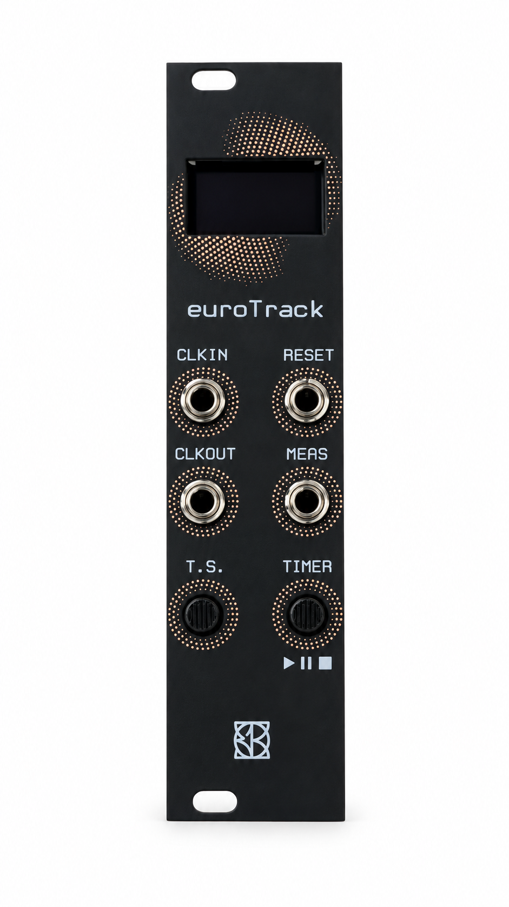
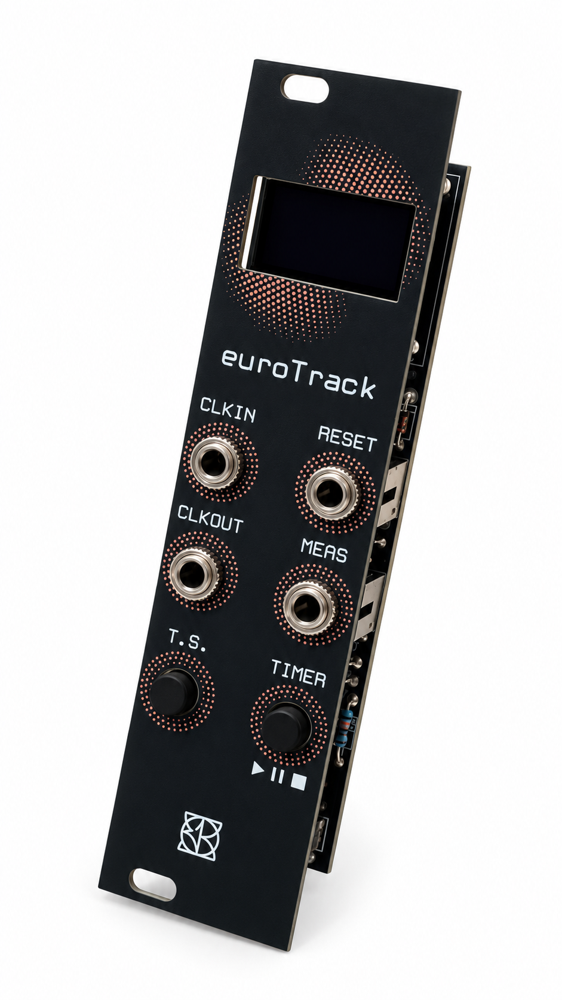
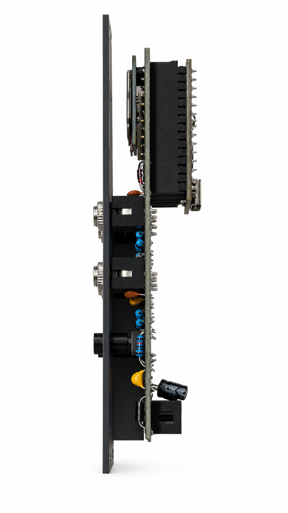
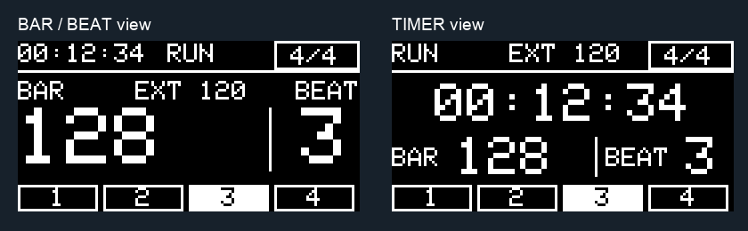
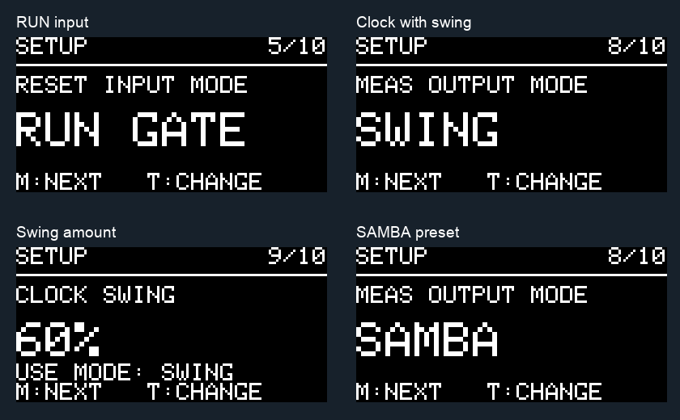

# euroTrack

### Keep your place in the patch.

**[Open the V4.2 firmware `.ino`](firmware/Eurotrack_V4_2_SingleFile/Eurotrack_V4_2_SingleFile.ino)** · [Display examples](docs/DISPLAY.md)

**An open-source Eurorack bar/beat counter, performance timer and clock utility.** Follow the musical position of an external clock, mark longer phrases, or run from the internal tempo — with a selectable **BAR/BEAT** or **TIMER** display.

 

More product views

[Quick start and controls](docs/USER_GUIDE.md) · [Guida italiana](docs/GUIDA_IT.md) · [Firmware](firmware/Eurotrack_V4_2_SingleFile/Eurotrack_V4_2_SingleFile.ino) · [Build and modify](docs/DEVELOPMENT.md) · [Schematics](hardware/schematics/README.md)

## At a glance

- **Musical position:** bars 1–9999, grouped beats and an elapsed-time display.
- **Seven meters:** 4/4, 3/4, 6/8, 5/4, 7/8, 9/8 and 12/8. Compound meters display rhythmic groups: 6/8 is two groups of three eighths; 7/8 is 2+2+3.
- **MEAS output:** phrase markers every 1/2/4/8/16 bars, straight sixteenth-note clock, 50–75% swing, or single-voice Samba, Bossa, Son 3-2 and Tresillo trigger patterns. Pulse length targets remain 5/10/20/50 ms, capped when needed to preserve a LOW gap.
- **External priority:** CLKIN expects **4 PPQN**, one pulse per sixteenth note. CLKOUT follows external transitions in software, or emits the internal clock when active.
- **Internal clock:** 50–250 BPM in steps of 5; enabled in the menu and active while the timer runs. It starts disabled after power-on.
- **Performance transport:** manual start/pause/resume, or **RUN GATE** on RESET IN. HIGH starts a new timer and resets bar/beat/pattern phase; LOW freezes the elapsed time and position and silences MEAS.
- **Two screen layouts:** BAR/BEAT for prominent musical position, TIMER for larger HH:MM:SS. The chosen view and musical settings persist in EEPROM.

## Display examples

The same performance in both layouts: bar 128, beat 3, elapsed time 00:12:34 and external 120 BPM clock. All information remains visible; the hierarchy changes.

V4.2 also adds RUN control, output modes and swing settings:

These are **128×64 software renders made by the firmware drawing functions**, enlarged without interpolation. They are not photographs of a physical OLED. [See STOP, maximum values and the complete preset gallery](docs/DISPLAY.md).

## Start patching

1. Connect a compatible **4 PPQN** source to **CLKIN**. At 120 BPM this is eight pulses per second. A different PPQN changes the displayed tempo and musical count.
2. The first accepted clock edge starts **bar 1 / beat 1** and produces a MEAS marker. Connect MEAS to a compatible trigger destination for phrase events.
3. Press **T.S.** once to open meter selection, then again to advance through the meters. Selection closes after three seconds.
4. Press **TIMER** briefly for start/pause/resume; hold about **one second** to stop and clear elapsed time.
5. Hold **T.S. + TIMER** for one second, release both, then use T.S. to select a menu item and TIMER to change it. **DISPLAY VIEW is item 7/10**, MEAS OUTPUT MODE is 8/10, CLOCK SWING is 9/10 and SAVE/EXIT is 10/10.

In BAR/BAR+TIME reset modes, the external-clock musical count continues during timer pause and RESET takes effect on the next clock. For slave transport, select **RESET INPUT MODE → RUN GATE** (5/10): each HIGH starts a fresh performance; LOW freezes timer and position and cancels MEAS pulses. The TIMER button controls menu values while the jack owns transport. Read the [full guide](docs/USER_GUIDE.md) for menu options, persistence and clock loss.

## Current firmware: V4.2

Firmware dated **8 November 2026**, for **classic Arduino Nano ATmega328P, 16 MHz**, with **SSD1306 I2C 128 × 64 at 0x3C**. Published update: 9 November 2026.

Open **[Eurotrack_V4_2_SingleFile.ino](firmware/Eurotrack_V4_2_SingleFile/Eurotrack_V4_2_SingleFile.ino)** inside its matching folder. The complete settings implementation is embedded; no `SettingsStore.h` is required. Download the repository with **Code → Download ZIP**, extract, and open this sketch. In Arduino Cloud, replace the contents of the already configured sketch or explicitly pin Adafruit BusIO 1.17.4 for a new import.

[V4.2 Italian manual](firmware/Eurotrack_V4_2_SingleFile/README.md) · [Validation report](firmware/Eurotrack_V4_2_SingleFile/VALIDATION.md) · [Build and test](docs/DEVELOPMENT.md)

**V4.2 is an engineering release with hardware qualification pending.** The verified build uses **22,214 bytes flash and 617 bytes static SRAM**, plus a **1,024-byte OLED heap buffer** and allocator overhead. About **407 bytes remain before stack/allocator overhead**. Nano compilation and the ASan/UBSan host suite pass; timing and electrical performance still need bench measurements.

V4.2 reads V4.0/V4.1 settings and migrates them to schema 3. Factory/imported defaults retain BAR reset and MEASURE output; select the new functions in the menu. The two historical V4.1 distributions remain available in `firmware/` for reference. Open one sketch at a time; never add another complete `.ino` as a second tab in the same sketch.

## What is in the repository

- `firmware/`: current single-file V4.2, manuals, verified binary, manifests, host tests and historical V4.1 distributions.
- `docs/`: English/Italian operation guides, a display gallery and reproducible build/development instructions.
- `images/`: product photographs.
- `hardware/schematics/`: circuit schematic, revision information and SHA-256 checksum; editable native CAD remains to be added.

**The circuit schematic is available in [hardware/schematics](hardware/schematics/README.md).** Editable native CAD and a revision-matched manufacturing package remain to be added. Safe jack voltage limits, power/USB arrangements, output buffering and PCB-to-firmware pin correspondence must be checked against that hardware release. Timing and pulse widths are software targets; CLKOUT is not a zero-latency hardware buffer.

## Make it yours

The [development guide](docs/DEVELOPMENT.md) maps clock handling, meter definitions, display rendering, buttons and EEPROM. It includes the exact dependency versions, compile commands, regression tests and the current single-file implementation and historical distributions. Contributions are welcome through focused pull requests with build results and the hardware revision stated.

Original project materials: **GNU GPL-3.0**. [License](LICENSE) · [Notice](NOTICE.md) · [Contributing](CONTRIBUTING.md).

Other E103 projects: [faun](https://github.com/E103-designs/faun) · [ALTERIA](https://github.com/E103-designs/ALTERIA) · [SINCRIA](https://github.com/E103-designs/SINCRIA).

