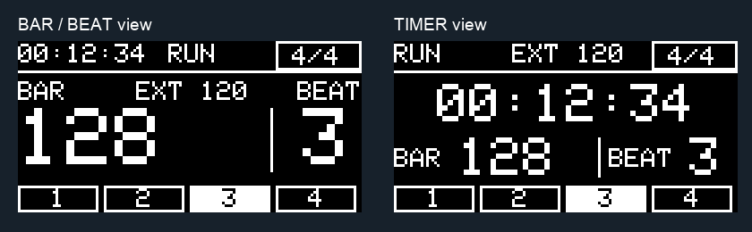
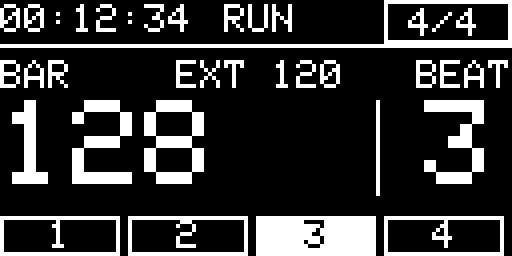
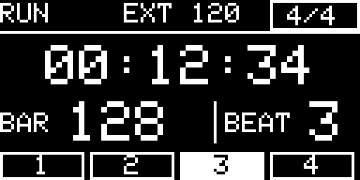
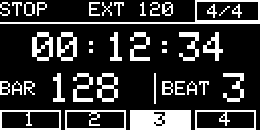
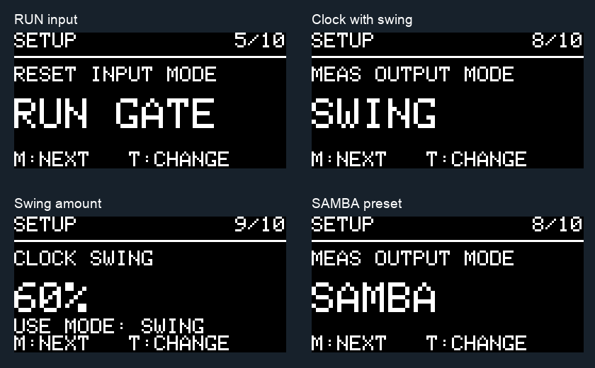
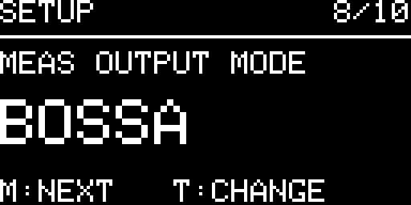
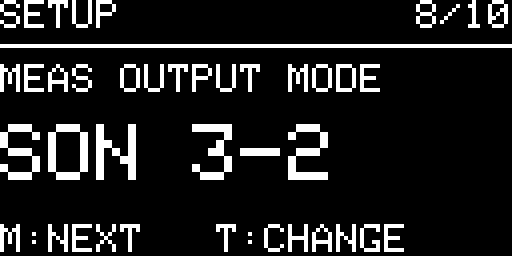
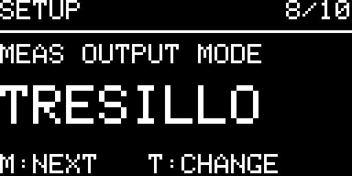
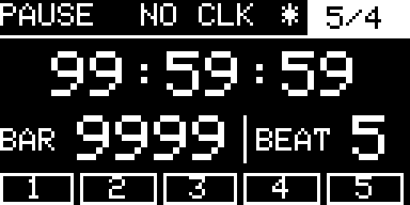

# Display gallery

All examples below are software renders of the V4.2 firmware using its real Adafruit GFX drawing functions and classic pixel font. Each OLED frame is 128×64; the PNGs are enlarged with nearest-neighbor scaling. They are not hardware photographs or measurements.

## The two performance views

Both views show elapsed HH:MM:SS, timer/transport state, clock source and BPM, meter, bar, grouped beat, beat strip, and conditional save/fault indicators. Switching view changes presentation without resetting the performance.

For a closer view, including narrow screens:

**BAR/BEAT**

**TIMER**

## RUN gate stops and holds the duration

With RESET INPUT MODE set to RUN GATE, HIGH starts a new performance; LOW freezes timer and bar/beat, silences MEAS and displays STOP. Each new HIGH starts from zero.

## Output and rhythm controls

The presets drive one trigger output. Samba and Bossa are simplified, inspired patterns; the exact step lists and cycle lengths are in the [user guide](USER_GUIDE.md#meas-output-modes).

## Maximum values

## Complete rendering set

[Open the complete 24-screen gallery](display/all-screens.png), including all ten menu items and both STOP/RUN layouts. The runner that generates the frames is [firmware_tests.cpp](../firmware/Eurotrack_V4_2_SingleFile/tests/firmware_tests.cpp); [render_previews.py](../firmware/Eurotrack_V4_2_SingleFile/tests/render_previews.py) converts the resulting PGM frames to PNG.
