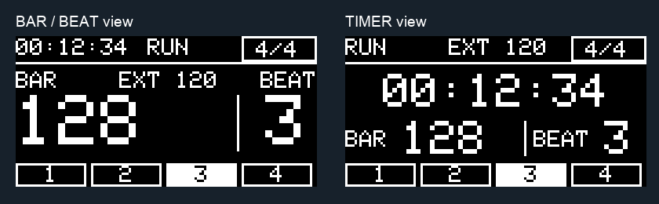

# euroTrack V4.2 — guida rapida

[Apri il firmware .ino](../firmware/Eurotrack_V4_2_SingleFile/Eurotrack_V4_2_SingleFile.ino) · [Manuale italiano completo](../firmware/Eurotrack_V4_2_SingleFile/README.md) · [Esempi del display](DISPLAY.md)

V4.2 dell'8 novembre 2026, per Nano classico ATmega328P a 16 MHz e SSD1306 I2C 128×64. Compilazione e test software superati; collaudo sul circuito reale ancora da completare.

## Clock e pulsanti

CLKIN richiede **4 PPQN**, un impulso per sedicesimo: a 120 BPM sono 8 impulsi al secondo. T.S. apre la selezione del metro; i clic successivi scorrono 4/4, 3/4, 6/8, 5/4, 7/8, 9/8 e 12/8. I beat mostrati sono gruppi: 6/8 è 3+3 ottavi; 7/8 è 2+2+3. La selezione si chiude dopo 3 secondi.

Nelle modalità BAR e BAR+TIME, TIMER breve avvia/pausa/riprende, mentre una pressione di circa un secondo ferma e azzera. Con clock esterno, la pausa del solo cronometro non ferma il conteggio. BAR+TIME applica al clock successivo il reset della posizione e lo stop/azzeramento del timer.

## Slave da RESET IN

Seleziona **RESET INPUT MODE → RUN GATE**, voce 5/10:

- HIGH avvia una nuova performance da zero e riallinea BAR/BEAT a 1/1 e il pattern MEAS al primo passo.
- Il primo CLOCK successivo è il primo sedicesimo; il timer misura invece dal fronte RUN.
- LOW ferma timer, conteggio e MEAS. La durata raggiunta resta visibile e compare STOP.
- Il successivo HIGH riparte da zero, senza riprendere la durata precedente.

L'ingresso già HIGH all'avvio o alla selezione della modalità viene riconosciuto. Il pulsante TIMER continua a operare nel menu, ma fuori dal menu il trasporto appartiene al jack. CLKOUT resta la copia del clock esterno anche a RUN LOW.

## Dieci voci di menu

Tenere T.S. e TIMER insieme per 1 secondo e rilasciarli entrambi. T.S. sceglie la voce; TIMER cambia il valore.

| Voce | Funzione |
| ---: | --- |
| 1/10 | MEASURE OUTPUT EVERY: 1/2/4/8/16 battute, solo in MEASURE |
| 2/10 | INTERNAL CLOCK: ON/OFF; torna OFF all'accensione |
| 3/10 | INTERNAL TEMPO: 50–250 BPM a passi di 5 |
| 4/10 | OUTPUT PULSE LENGTH: 5/10/20/50 ms, con limite per preservare LOW nei clock/preset |
| 5/10 | RESET INPUT MODE: BAR, BAR+TIME, RUN GATE |
| 6/10 | TIMER BUTTON CONTROLS: TIME o TIME+BAR; superato da RUN GATE |
| 7/10 | DISPLAY VIEW: BAR/BEAT oppure TIMER |
| 8/10 | MEAS OUTPUT MODE: MEASURE, CLOCK, SWING, SAMBA, BOSSA, SON 3-2, TRESILLO |
| 9/10 | CLOCK SWING: 50/55/60/65/70/75%, solo in SWING |
| 10/10 | STORE SETTINGS: TIMER salva/esce |

Le impostazioni si salvano automaticamente un secondo dopo l'ultima modifica. Attendere che `*` scompaia prima di spegnere. CLOCK è dritto a sedicesimi; SWING ritarda il secondo sedicesimo di ciascuna coppia. A 120 BPM, 60% alterna 150/100 ms. I preset sono una sola voce di trigger, con cicli fissi di 16 o 32 passi: [sequenze esatte nel manuale](../firmware/Eurotrack_V4_2_SingleFile/README.md#nuove-funzioni-di-meas-out).

## Due viste, tutti gli elementi

Sono rendering software del firmware, non fotografie del display fisico. Entrambe mostrano tempo, stato, sorgente/BPM, metro, battuta, beat e fascia ritmica. Cambiano dimensioni e disposizione; la scelta viene conservata dopo lo spegnimento.

## Installazione e verifica

Aprire il singolo `.ino` nella cartella omonima; non serve SettingsStore.h. Non unire più sketch completi. Nel Cloud Editor è possibile sostituire il contenuto dello sketch già configurato, oppure selezionare esplicitamente Adafruit BusIO 1.17.4 nel nuovo sketch se viene scelta EIS.

La V4.2 migra i record V4.0/V4.1 allo schema 3 senza riscrivere i byte V3.9. Non cancellare l'EEPROM se si vuole migrare. Restano da misurare jitter, livelli dei jack, comportamento durante interruzioni di alimentazione e margine dello stack: [rapporto di verifica](../firmware/Eurotrack_V4_2_SingleFile/VALIDATION.md).
