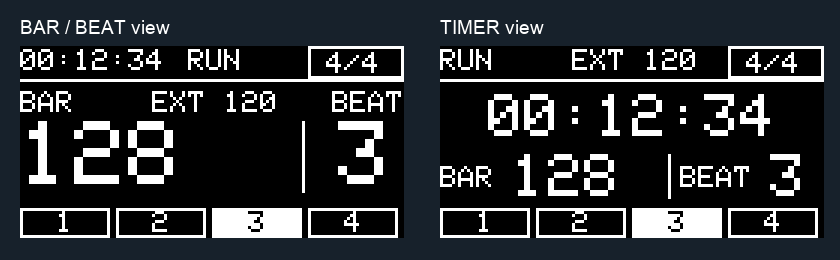

# euroTrack V4.2 user guide

## Clock and position

CLKIN expects **4 PPQN**, one rising edge per sixteenth note. BPM is expressed in quarter notes, including compound meters. At 120 BPM the input is 8 Hz; in 4/4 a bar is 16 clock edges. The first accepted edge after startup or a pending reset denotes bar 1 / beat 1 / subdivision 0 and emits a MEAS pulse in MEASURE mode.

The displayed beat is a musical group, not always an individual denominator note:

| Meter | Groups in eighth-note terms | Displayed beats per bar | 4-PPQN ticks per bar |
| --- | --- | --- | --- |
| 4/4 | Four quarter notes | 4 | 16 |
| 3/4 | Three quarter notes | 3 | 12 |
| 6/8 | 3+3 eighths | 2 | 12 |
| 5/4 | Five quarter notes | 5 | 20 |
| 7/8 | 2+2+3 eighths | 3 | 14 |
| 9/8 | 3+3+3 eighths | 3 | 18 |
| 12/8 | 3+3+3+3 eighths | 4 | 24 |

Bars wrap from 9999 to 1 without restarting the phrase-marker cadence. In MEASURE output mode, MEAS emits at the first bar and then every selected 1/2/4/8/16 bars. Pulse lengths are requested at 5/10/20/50 ms and serviced cooperatively: actual widths and jitter require measurement.

CLKOUT copies both external clock transitions from an interrupt. Very short rising-edge intervals (under 1000 microseconds) are rejected for counting, but THRU still copies the external waveform. It does not clean up electrical glitches. In BAR/BAR+TIME modes, RESET is ordered with clock events and takes effect on the next clock; it does not retroactively reset earlier queued events.

External clock has priority. After **1500 ms** without a valid rising edge, the display reports no clock, or the internal source resumes if enabled and the timer is RUN. Internal fallback starts with an immediate pulse; it does not predict the removed clock's phase. At 4 PPQN, this timeout is unsuitable for masters with more than 1.5 s between edges. The internal range is 50–250 BPM in 5-BPM steps; internal CLKOUT pulses target 5 ms independently of MEAS length.

## Buttons

Panel **T.S.** corresponds to METER in firmware documentation. Short actions occur on release after 25 ms debounce.

| Gesture | Action |
| --- | --- |
| T.S. short | Open meter selection; subsequent presses advance the seven meters |
| TIMER short | Start / pause / resume elapsed time |
| TIMER held 1 s | Stop and clear elapsed time; also reset position in TIME+BAR mode |
| Both held 1 s, then both released | Enter setup without executing the short actions |
| T.S. in setup | Next item, wrapping after 10 |
| TIMER in setup | Change selected item, or save/exit at item 10 |

Meter selection closes after 3 seconds. Changing the meter restarts musical position at bar 1 on the next clock. In BAR/BAR+TIME modes, external clocks continue counting while elapsed time is stopped or paused. In RUN GATE, the jack controls timer, count and MEAS together; TIMER gestures outside setup do not change transport. Internal clocks require timer RUN.

## Setup menu

| Item | Display/function | Values / meaning |
| --- | --- | --- |
| 1/10 | MEASURE OUTPUT EVERY | 1, 2, 4, 8, 16 bars; only in MEASURE mode |
| 2/10 | INTERNAL CLOCK | ON/OFF; always OFF after boot, not saved |
| 3/10 | INTERNAL TEMPO | 50…250 BPM, steps of 5; default 120 |
| 4/10 | OUTPUT PULSE LENGTH | 5, 10, 20, 50 ms; derived outputs cap width to preserve LOW gaps |
| 5/10 | RESET INPUT MODE | BAR, BAR+TIME, or RUN GATE |
| 6/10 | TIMER BUTTON CONTROLS | TIME or TIME+BAR; overridden while RUN GATE owns transport |
| 7/10 | DISPLAY VIEW | BAR/BEAT or TIMER; visual only |
| 8/10 | MEAS OUTPUT MODE | MEASURE, CLOCK, SWING, SAMBA, BOSSA, SON 3-2, TRESILLO |
| 9/10 | CLOCK SWING | 50/55/60/65/70/75%; only in SWING mode |
| 10/10 | STORE SETTINGS | TIMER requests SAVE/EXIT |

Persistent settings autosave **one second after the last change**, even before SAVE/EXIT. There is no cancel-and-revert menu operation. Internal clock enable is intentionally not persistent; its BPM is persistent.

## RUN gate transport

Select RESET INPUT MODE → RUN GATE. A rising HIGH starts a **new** performance: elapsed time becomes zero, bar/beat returns to 1/1, and MEAS pattern phase returns to step 1. The first subsequent clock is the first sixteenth; elapsed time starts at the RUN edge itself. Sustained HIGH keeps transport running. LOW freezes timer and position, drives MEAS LOW and cancels delayed swing events. The duration stays visible; the next HIGH restarts from zero.

An input already HIGH at boot or when the role is selected starts transport immediately. TIMER remains available for setup but cannot start/pause/clear transport outside setup while slaved. Selecting a different RESET role resets the transport context. CLKOUT still copies external clock transitions even while RUN is LOW.

## MEAS output modes

CLOCK emits one straight pulse per sixteenth note (4 PPQN). SWING delays every second sixteenth within a pair while preserving the following on-grid edge. At 120 BPM, 60% produces alternating 150/100 ms intervals; 75% produces 187.5/62.5 ms. 50% is straight. Swing affects MEAS only, not CLKIN or CLKOUT.

Rhythm presets are **single-voice trigger patterns**, not complete drum arrangements:

| Preset | Sixteenth-note cycle | Trigger steps, starting at 1 |
| --- | ---: | --- |
| SAMBA | 16 | 1, 4, 5, 7, 9, 12, 13, 15 |
| BOSSA | 32 | 1, 7, 13, 21, 27 |
| SON 3-2 | 32 | 1, 7, 13, 21, 25 |
| TRESILLO | 16 | 1, 7, 13 |

Samba is an original syncopated variation inspired by the style; Bossa is a simplified clave-inspired pattern. Cycle lengths stay fixed when the meter changes, so they may cross bar boundaries in non-4/4 meters. RESET, RUN start, meter/source changes and output-mode changes realign the output phase. Changing swing also clears the pending output and realigns its phase.

For CLOCK/SWING/presets, requested pulse width is capped at half the shortest expected interval. The first pulse before period acquisition is capped at 5 ms. MEASURE retains the selected 5/10/20/50 ms target. Events more than 5 ms late are discarded with `!` rather than emitted in catch-up bursts. RUN LOW cancels all pending output; a RUN queue overflow fails closed until a new LOW/HIGH cycle.

## Display

**BAR/BEAT** gives large musical-position digits and a compact timer. **TIMER** enlarges HH:MM:SS while retaining bar/beat information. Both show state, clock source/BPM, meter and a beat strip. These examples are **software renders using the firmware drawing functions**, not photographs of a running OLED:

[More display examples and menu screens](DISPLAY.md).

`READY`, `RUN` and `PAUSE` describe the manual timer. RUN GATE uses `RUN` and `STOP`. `EXT`/`INT` identify the clock source; `EXT ---` awaits a valid measured interval. `NO CLK` means no active source. `*` signals a pending or ongoing save: wait for it to disappear before powering down if the latest settings should persist. `!` flags queue loss or a severe internal-clock delay; resynchronize with RESET.

The stopwatch uses 32-bit millisecond arithmetic, with a continuous-run horizon of about 49.7 days; displayed hours wrap after 99. It is a performance timer, not a long-term data logger.

## Persistence and updates

V4.2 settings use schema 3, two CRC-protected 11-byte records at EEPROM **32–42 and 64–74**. The commit marker is written last. It reads schema 1 (V4.0), schema 2 (V4.1) and legacy V3.9 bytes 0–5; schema 1 imports BAR/BEAT while schema 2 preserves the saved view. Legacy bytes are not rewritten. New/imported defaults keep BAR reset and MEASURE output; swing defaults to 60%.

Avoid erasing EEPROM if you want migration. Older firmware may not understand schema 3 and may fall back to older stored values. Changing firmware does not guarantee settings portability unless the reader implements this format.

## Troubleshooting and limits

| Symptom | Check |
| --- | --- |
| BPM/count differs from the master | Confirm 4 PPQN; check meter grouping and accepted pulse rate |
| Internal clock does not run | Enable item 2 and start TIMER; a connected external source takes priority |
| Pausing timer does not stop bars | Expected in BAR/BAR+TIME modes; choose RUN GATE to slave timer, count and MEAS together |
| New meter is not selected on the first press | First T.S. press opens selection; subsequent presses change it |
| Missing SettingsStore.h | Use the complete modular folder, or the self-contained SingleFile sketch |
| Clock lost after a very slow source | External timeout is 1500 ms between valid rising edges |
| Blank OLED | Check address 0x3C, wiring, 128×64 model and supply; the firmware can continue headless after an OLED fault |
| `!` on display | Events were lost or internal servicing stalled; reset/re-sync and investigate load/timing |

Use only levels established safe for the assembled board. Software pin modes and the Nano's logic rail are not a verified specification for the external jacks. The [validation report](../firmware/Eurotrack_V4_2_SingleFile/VALIDATION.md) lists remaining hardware, stack, brownout and timing checks.
