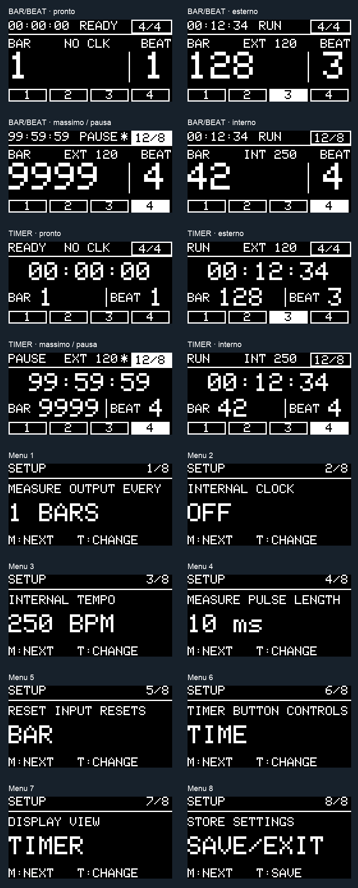

# Eurotrack V4.1 — candidato per collaudo

Revisione V4.1 del 20 ottobre 2026: integra nella V4.0 le due viste approvate, con selezione persistente. La cartella V4.0 precedente resta disponibile.
Target confermato: **Arduino Nano classico ATmega328P a 16 MHz**, SSD1306 I2C 128×64 a `0x3C`, **4 PPQN** (un impulso per sedicesimo).

Il codice è compilato e verificato in simulazione software. Non è ancora una release qualificata per la vendita: temporizzazione reale, margine di stack e comportamento elettrico richiedono il prototipo.

## Aprire e caricare

Aprire `Eurotrack_V4_1.ino` nell'IDE Arduino. `SettingsStore.h` deve rimanere nella stessa cartella. Selezionare Arduino Nano, processore ATmega328P; usare «Old Bootloader» soltanto se il Nano montato lo richiede. Il processore e la frequenza restano gli stessi.

Dipendenze usate nella verifica:

- Arduino AVR Boards **1.8.6**.
- Adafruit SSD1306 **2.5.17**.
- Adafruit GFX **1.12.6**.
- Adafruit BusIO, versione indicata in `VALIDATION.md`.
- Wire ed EEPROM del core AVR.

Non sono richieste nuove connessioni. I pin restano quelli del sorgente fornito:

| Funzione | Pin | Configurazione |
|---|---|---|
| CLOCK IN | D2 | INPUT, interrupt CHANGE |
| RESET IN | D3 | INPUT, interrupt RISING |
| Pulsante METER | D4 | INPUT_PULLUP, attivo LOW |
| CLOCK THRU | D5 | OUTPUT |
| MEASURE OUT | D6 | OUTPUT |
| Pulsante TIMER | D7 | INPUT, attivo HIGH, pull-down esterno |
| OLED SDA / SCL | A4 / A5 | I2C a 400 kHz |

`TIMER_BUTTON_USES_PULLUP` resta `0`: cambiarlo in `1` richiede un cablaggio verso GND. La distinta disponibile conferma Nano e SSD1306; la corrispondenza dei pin sulle PCB è mantenuta dal firmware originale, **non ricostruita elettricamente dai Gerber**.

## Display e uso

**Due viste selezionabili:** tenere entrambi i pulsanti per 1 secondo, rilasciarli e premere METER fino a **DISPLAY VIEW** (voce **7/8**). TIMER alterna **BAR/BEAT** e **TIMER**; METER passa a **SAVE/EXIT** (8/8), poi TIMER salva ed esce. La scelta viene salvata anche automaticamente dopo un secondo dall'ultima modifica e ripristinata alla successiva accensione.

**BAR/BEAT** mantiene i numeri musicali a scala 3 e il cronometro compatto. **TIMER** usa il cronometro completo HH:MM:SS a scala 2, come nella V3.9, con BAR e BEAT a scala 2. Entrambe mostrano stato, sorgente clock/BPM, metro, avvisi e fascia dei beat. Cambiano dimensioni e disposizione; il cambio non azzera né mette in pausa il timer o il conteggio. La vista iniziale, anche importando impostazioni precedenti, è BAR/BEAT.

- Vista BAR/BEAT, riga superiore: cronometro `HH:MM:SS`, stato `READY`, `RUN` o `PAUSE`, metro. Il metro si inverte durante la selezione.
- Vista BAR/BEAT, centro: numero di battuta `BAR` a caratteri grandi, beat corrente a destra. `EXT 120` = clock esterno a 120 BPM; `INT 120` = clock interno a 120 BPM; `NO CLK` = nessun clock attivo. `EXT ---` compare finché non è disponibile un intervallo valido.
- Fascia inferiore: gruppi ritmici proporzionali, con il beat corrente invertito. Non vengono mescolate cifre e riempimento parziale dentro lo stesso beat.
- `*` accanto allo stato: salvataggio in attesa o in corso; attendere che scompaia prima di togliere alimentazione se si vogliono conservare le ultime modifiche.
- `!`: perdita della coda o ritardo grave del clock interno; conteggio da risincronizzare. Un RESET esterno cancella l'avviso e riallinea la posizione al clock successivo.

**METER:** primo clic apre la selezione; i clic successivi cambiano metro. Dopo 3 secondi si torna alla visualizzazione normale. La modifica riparte dalla battuta 1 al prossimo impulso.

**TIMER:** clic breve per start / pausa / ripresa; pressione di 1 secondo per stop e azzeramento del cronometro. In modalità `TIME+BAR`, start da fermo e stop azzerano anche il contatore. Con clock esterno, mettere in pausa il cronometro non ferma il conteggio musicale.

**Menu:** tenere entrambi i pulsanti per 1 secondo e poi rilasciarli. `M:NEXT` sceglie la voce; `T:CHANGE` cambia il valore. Alla voce `SAVE/EXIT`, TIMER richiede il salvataggio ed esce. Le impostazioni persistenti vengono salvate automaticamente anche dopo un secondo dall'ultima modifica; «SAVE» non è un'operazione di conferma o annullamento delle modifiche precedenti.

Le azioni brevi sono eseguite al **rilascio** e passano dal medesimo debounce anche nel menu. Questo evita modifiche involontarie al metro quando si preme la combinazione di ingresso.

## Comportamento musicale definito

- Il primo CLOCK dopo l'avvio indica **battuta 1 / beat 1 / suddivisione 0** e genera MEASURE OUT. È una correzione dell'avanzamento anticipato presente nella V3.9.
- RESET viene applicato al primo CLOCK che lo segue, rispettando l'ordine degli eventi: i CLOCK già in coda prima del RESET non vengono azzerati retroattivamente.
- MEASURE OUT genera un impulso alla prima battuta e poi ogni 1, 2, 4, 8 o 16 battute. Durate selezionabili: 5, 10, 20, 50 ms.
- Il contatore visualizza 1…9999 e poi riparte da 1. La cadenza di MEASURE OUT continua indipendentemente da questo ritorno.
- Metri invariati: 4/4, 3/4, 6/8, 5/4, 7/8, 9/8, 12/8. Il beat mostrato è un **gruppo**: 6/8 = 3+3 ottavi, 7/8 = 2+2+3 ottavi; quindi in 6/8 compaiono 2 beat e in 7/8 ne compaiono 3.
- Il clock esterno ha priorità. Dopo **1500 ms** senza fronti validi, viene indicata l'assenza di clock o riprende l'interno se abilitato e il timer è RUN. L'oscillatore interno riparte con un impulso immediato: non tenta di prevedere la fase del clock scollegato.
- Clock interno: 50…250 BPM, passi di 5. L'abilitazione non viene salvata e rimane OFF all'avvio, come nella V3.9. Il tempo impostato viene salvato.
- La misura BPM è riferita al quarto, anche nei metri composti; il display del tempo esterno viene smussato senza modificare il conteggio degli impulsi.
- Il filtro scarta fronti di salita distanti meno di 1000 µs. La soglia precedente di 5000 µs è stata ridotta. CLOCK THRU continua a seguire la forma d'onda elettrica esterna, inclusi disturbi scartati dal conteggio: la pulizia elettrica resta compito del circuito di ingresso.

## Correzioni di affidabilità

1. **OLED a blocchi:** un framebuffer da 1024 byte, trasferito in transazioni di 16 byte. Tra i blocchi vengono serviti CLOCK, RESET, uscite e pulsanti; non si richiama `display.display()` nel loop. Il framebuffer rimane immutabile durante la trasmissione. Refresh massimo richiesto: 20 Hz, solo su modifica.
2. **I2C con timeout:** timeout di 1500 µs e gestione degli errori/NACK. Un guasto OLED sospende le trasmissioni; il firmware continua a gestire clock e timer. La reinizializzazione viene tentata ogni 2 secondi solo con timer non RUN e nessun clock attivo. Se il display manca, la sola schermata non può segnalare il guasto; servono verifica di fabbrica e, per una diagnosi indipendente, un indicatore hardware.
3. **Clock interno:** scadenze ancorate alla fase e resto frazionario, senza sommare il ritardo del loop a ogni impulso. Un ritardo grave non provoca raffiche di recupero. Non è un generatore a temporizzazione hardware: il jitter va misurato.
4. **Concorrenza:** accessi condivisi protetti con ripristino dello stato degli interrupt; priorità dell'uscita esterna protetta durante la chiusura degli impulsi interni.
5. **Eventi ordinati:** coda di 16 elementi, 15 utilizzabili, con rilevamento dell'overflow. In caso di overflow i dati incompleti vengono scartati e si riparte dalla battuta 1 al prossimo CLOCK, con `!` visibile. Non si prosegue silenziosamente con un conteggio errato.
6. **EEPROM:** due record con versione, sequenza, CRC-8 e commit scritto per ultimo. Scrittura asincrona di un byte alla volta con verifica EEPE, evitando l'attesa di programmazione nel loop. Se un record è incompleto o corrotto, si usa quello valido precedente. Il modello non garantisce contro corruzioni simultanee di entrambi i record o alimentazione fuori specifica.
7. **Migrazione:** i record della V4.0 (schema 1) vengono letti integralmente, con vista predefinita BAR/BEAT, e aggiornati allo schema 2 tramite il protocollo a doppio record. La vista occupa un bit libero dello stesso byte del modo TIMER; dimensione e indirizzi dei record restano invariati. La V4.0 non legge lo schema 2: tornando al vecchio firmware può essere ancora disponibile un record schema 1, oppure vengono recuperati i vecchi byte V3.9. I byte V3.9 a indirizzi 0…5 vengono letti e validati soltanto se non esiste un record V4 valido. I nuovi record occupano 32…42 e 64…74; i vecchi byte non vengono riscritti. Tornando alla V3.9 si ritrovano quindi le precedenti impostazioni V3.9. Non cancellare l'EEPROM durante l'aggiornamento se si vuole migrare.
8. **Avvio:** le uscite vengono impostate LOW prima delle operazioni su display e memoria. Nessun ciclo infinito in caso di mancata allocazione del framebuffer o display assente.

Le durate delle uscite e l'emissione del clock interno restano cooperative: la latenza comprende elaborazione del loop e una transazione I2C. Un blocco sano richiede teoricamente circa 0,4 ms sul bus a 400 kHz, più overhead; rendering e guasti possono aumentare il ritardo. Questo firmware riduce il blocco del display, ma **non certifica jitter o impulsi esatti al microsecondo**.

## Verifica e rilascio

Vedere `VALIDATION.md` per compilazione, risultati, limiti della simulazione e collaudi sul prototipo. `tests/run_tests.sh` esegue i test host e genera i frame PGM con Adafruit GFX reale. `tests/render_previews.py` produce le PNG e la tavola di anteprima; richiede Pillow. Nessun test carica il firmware sulla scheda.

Non è stato aggiunto un watchdog: deve essere deciso insieme al bootloader effettivamente montato e provato con le condizioni di guasto, per evitare cicli di riavvio sui Nano con bootloader incompatibile. Il cronometro usa aritmetica a 32 bit con gestione del passaggio di `millis()`; una singola esecuzione continuativa rimane limitata al periodo di circa 49,7 giorni e la visualizzazione delle ore ritorna a 00 dopo 99.

Riferimenti tecnici primari consultati: [Wire.setWireTimeout](https://docs.arduino.cc/language-reference/pt/fun%C3%A7%C3%B5es/communication/wire/setWireTimeout), [driver Adafruit SSD1306](https://github.com/adafruit/Adafruit_SSD1306/blob/master/Adafruit_SSD1306.cpp). Le verifiche di build sono riferite alle versioni locali sopra riportate, non a versioni future delle librerie.
